# Execution Results & Bug Reports

| | |
|---|---|
| Environment | https://qae-assignment-tau.vercel.app/ |
| Browser | Chrome desktop (latest) |
| API docs | Swagger UI at `/api/docs` |
| Execution date | 2026-11-13 |
| Upcoming match | `eredivisie-ajax-az-2026-11-21` (Ajax vs AZ Alkmaar, odds 1.85 / 3.70 / 4.40) |
| Past match | `premier-league-manutd-chelsea` (2026-02-27) |
| Also reproduced on | `ligue-1-marseille-psg-2026-11-17` (upcoming): BUG-03, BUG-01, seen during the automated test runs |

## Key findings

The backend doesn't enforce the main business rules. Negative stakes (BUG-06), stakes above the balance (BUG-09) and bets on past matches (BUG-07) are all accepted by the API. A single request with a stake of -5,000,000, sent from the browser console, added €5 million to the balance. The UI blocks negative stakes, but not the other two: a user can take the balance negative just by placing two bets in the app.

These three should be looked at first. Together they let a user create money, bet money they don't have, and bet on results that are already known.

Next are duplicate bets (BUG-10, BUG-17): a normal double click on Place Bet charges the user twice, but only one receipt is shown.

## Execution Summary

| Scenario | Check | Layer | Result | Bug |
|---|---|---|---|---|
| TC-01: Place a valid single bet | Bet slip shows match, selection, odds (Ajax vs AZ, AWAY @ 4.40); stake €10, payout = stake × odds (€44.00) | UI | ✅ Pass |  |
| | `Placing...` shown, odds buttons disabled while placing | UI | ✅ Pass |  |
| | Receipt match shows home vs away | UI | ❌ Fail | BUG-01 |
| | Receipt shows the selection | UI | ❌ Fail | BUG-02 |
| | Receipt stake and odds correct | UI | ✅ Pass |  |
| | Receipt payout = stake × odds | UI | ❌ Fail | BUG-03 |
| | Balance deducted by the stake (backend) | API | ✅ Pass |  |
| | Balance updated in header and bet slip | UI | ❌ Fail | BUG-04 |
| | Response currency is EUR | API | ❌ Fail | BUG-05 |
| | Bet slip empty after closing the receipt | UI | ✅ Pass |  |
| TC-02: Stake limits and format | `0.99`, `0`: "Minimum stake is €1.00", Place Bet disabled | UI | ✅ Pass |  |
| | `100.01`: "Maximum stake is €100.00", Place Bet disabled | UI | ✅ Pass |  |
| | `1.234` cut to `1.23`; `abc`, `-5`, empty blocked | UI | ✅ Pass |  |
| | `1.00`, `1.01`, `100.00` accepted | UI | ✅ Pass |  |
| | `0.99`, `0`, `100.01`, `1.234`, `"abc"`, missing stake: 422 | API | ✅ Pass |  |
| | `1.00`: 200 (API uses €1.00 as the minimum) | API | ✅ Pass |  |
| | `-5`: 422 | API | ❌ Fail | BUG-06 |
| TC-03: Only upcoming matches can be bet on | Past match can't be bet on | UI + API | ❌ Fail | BUG-07 |

## Exploratory checks

Checks around the bet flow, outside the planned scenarios:

| Area | Check | Layer | Result | Bug |
|---|---|---|---|---|
| Reset / balance | `reset-balance` response matches the stored balance | API | ❌ Fail | BUG-08 |
| API responses | Currency is EUR in every endpoint | API | ❌ Fail | BUG-05 |
| Bypassing the UI | A `place-bet` request replayed from DevTools with stake -5,000,000 is rejected | API | ❌ Fail | BUG-06 (steps B) |
| Stake vs balance (TC-04 area) | Stake higher than the balance is rejected | API | ❌ Fail | BUG-09 |
| | Second €100 bet, placed after closing the first receipt, is blocked as insufficient balance | UI | ❌ Fail | BUG-09 |
| | Stake higher than the balance is blocked when the shown balance is up to date | UI | ✅ Pass |  |
| Double submit (TC-05 area) | 5 identical requests sent at the same time: only one bet placed | API | ❌ Fail | BUG-10 |
| | Clicking Place Bet several times while it shows `Placing...`: only one bet placed | UI | ❌ Fail | BUG-17 |
| Payout maths | API payout = stake × odds, for several stakes and odds | API | ❌ Fail | BUG-11 |
| Request errors | Malformed JSON: 400 | API | ❌ Fail | BUG-12 |
| | `GET /api/place-bet`: 405 | API | ❌ Fail | BUG-13 |
| | Missing or unknown `x-user-id`: 401 | API | ✅ Pass |  |
| | Invalid selection, unknown or blank `matchId`: 422 | API | ✅ Pass |  |
| Request tampering | Extra `odds` / `payout` fields in the request are ignored | API | ✅ Pass |  |
| Injection | SQL, NoSQL and XSS payloads in `x-user-id`, `matchId` and `selection` are rejected (401 / 422) | API | ✅ Pass |  |
| Filters | Odds filter rejects min > max with a clear message | UI | ❌ Fail | BUG-14 |
| | Odds filter includes the min and max values | UI | ❌ Fail | BUG-15 |
| | Match counter shows the filtered number | UI | ❌ Fail | BUG-16 |
| | Date filter: single day, inclusive range, range picked in reverse order | UI | ✅ Pass |  |
| | Odds filter range matches the valid odds (1.01 to 1000.00) | UI | ⚠️ Unclear | Spec ambiguity #3 |
| Large balance | Header formats the amount after the -5,000,000 bet | UI | ❌ Fail | Cosmetic, not reported |

17 bugs in total: 3 Critical, 5 High, 7 Medium, 2 Low.

## Bugs

Sorted by severity. The Critical bugs are expanded, click any other bug to open it.

<details open>
<summary><b>BUG-06: API accepts a negative stake and adds money to the balance</b> · Critical</summary>

| Field | Details |
|---|---|
| Severity | Critical |
| Layer | API (no backend validation) |
| Found in | TC-02 (API) |

Steps to reproduce

A. With the API
1. `POST /api/reset-balance`, then `GET /api/balance`, note the balance.
2. `POST /api/place-bet` with header `x-user-id: <id>` and body:
   ```json
   { "matchId": "eredivisie-ajax-az-2026-11-21", "selection": "AWAY", "stake": -5 }
   ```
3. `GET /api/balance`.

B. From the browser, no tools needed (skips the UI validation)
1. Place a normal €1 bet in the app.
2. DevTools, Network tab, right-click the `place-bet` request, Copy as fetch.
3. Paste it in the Console, change `"stake":1` to `"stake":-5000000` and run it.
4. Refresh the page.

Expected: 422 with a minimum stake error (§4.1). Balance unchanged.

Actual: 200 "Bet placed successfully" with `stake: -5`, `payout: -22`, and the balance goes up by €5. With steps B, a stake of -5,000,000 was accepted from the console and added to the balance.

```json
{ "message": "Bet placed successfully", "matchId": "eredivisie-ajax-az-2026-11-21",
  "selection": "AWAY", "stake": -5, "odds": 4.4, "payout": -22, "balance": 130, "currency": "USD" }
```

Note: the UI blocks negative stakes correctly, the server doesn't. `0` and `0.99` get `invalid_stake_min` but `-5` passes, so it looks like the minimum check only covers values between 0 and 1.

Business Impact: any user can add unlimited money to their account using only the browser's DevTools, then bet it and get real winnings paid out on money that was never deposited.

Evidence:

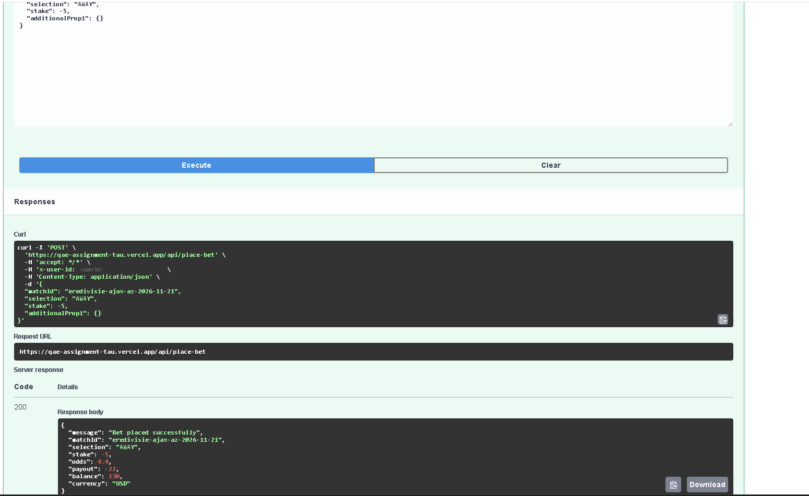<br>
<sub>API: stake -5 accepted (200)</sub>

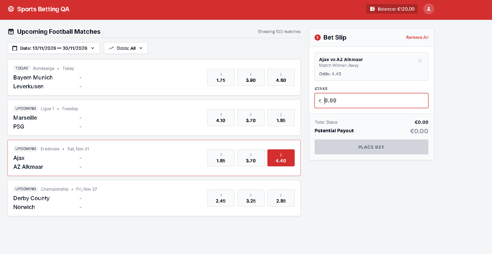<br>
<sub>UI: -5 is blocked correctly</sub>

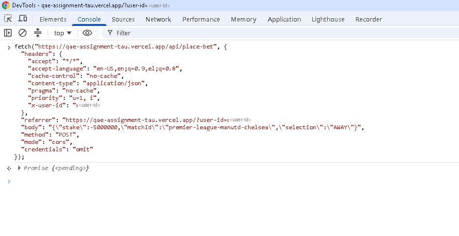<br>
<sub>Request with stake -5,000,000 sent from the browser console</sub>

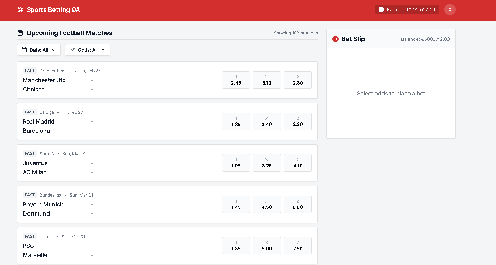<br>
<sub>Balance after: €5,005,712.00</sub>

</details>

<details open>
<summary><b>BUG-07: Bets are accepted on matches that were already played</b> · Critical</summary>

| Field | Details |
|---|---|
| Severity | Critical |
| Layer | UI + API |
| Found in | TC-03 |

Steps to reproduce
1. Open the app. The list ("Upcoming Football Matches") starts with matches labelled PAST, e.g. Manchester Utd vs Chelsea, Fri Feb 27.
2. Select odds on that match, enter `10`, click Place Bet. A success receipt appears.
3. With the API: `POST /api/place-bet` with `{ "matchId": "premier-league-manutd-chelsea", "selection": "HOME", "stake": 10 }`.

Expected: only upcoming matches are listed and accepted (§1, §3 "Upcoming matches only"). The API rejects past matches with 422.

Actual: past matches are listed and can be selected, and the bet goes through. The API returns 200 and takes the stake:
```json
{ "message": "Bet placed successfully", "matchId": "premier-league-manutd-chelsea",
  "selection": "HOME", "stake": 10, "odds": 2.45, "payout": 24.5, "balance": 110, "currency": "USD" }
```

Business Impact: users can bet on matches where they already know the result. Guaranteed loss for us, and a compliance problem.

Evidence: API response above.

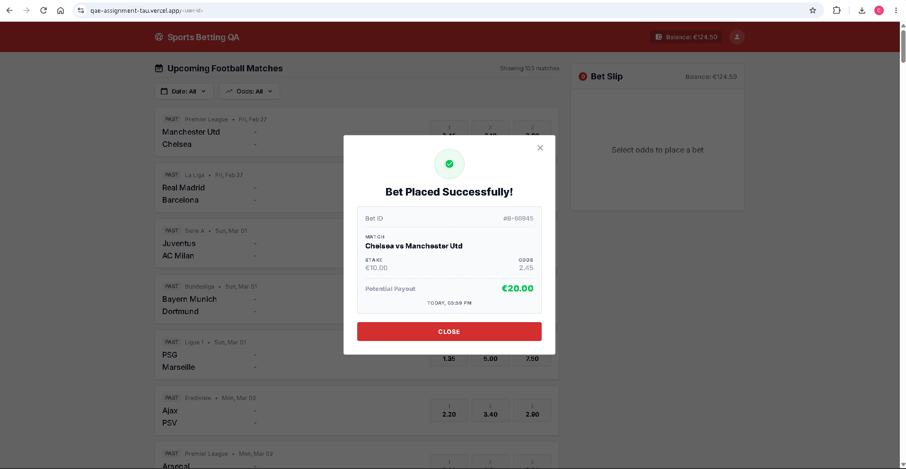<br>
<sub>Success receipt for a past match</sub>

</details>

<details open>
<summary><b>BUG-09: Stakes above the balance are accepted and the balance goes negative, from the API and the UI</b> · Critical</summary>

| Field | Details |
|---|---|
| Severity | Critical |
| Layer | API (no backend check) + UI (checks against an old balance) |
| Found in | Exploratory (TC-04 area, not executed) |

Steps to reproduce

A. In the app, no tools needed
1. Reset the balance (€120) and open the app.
2. Place a €100 bet on any upcoming match. The header still shows €120 (BUG-04), the real balance is €20.
3. Place another €100 bet. Place Bet is enabled and the bet goes through.
4. Refresh the page. The balance is €-80.

B. With the API
1. `POST /api/reset-balance`
2. `POST /api/place-bet` with stake `60`, then again with stake `50`. The balance is now €10.
3. `POST /api/place-bet`:
   ```json
   { "matchId": "ligue-1-marseille-psg-2026-11-17", "selection": "HOME", "stake": 11 }
   ```
4. `GET /api/balance`

Expected: the bet is rejected (422, insufficient balance), because the stake can't be higher than the current balance (TC-04, Domain Context: Stake). Balance unchanged.

Actual:
- A: both bets are accepted and the balance ends at €-80.
- B: 200 "Bet placed successfully" and the balance is -1. I kept placing bets and got it down to -12.

```json
{ "message": "Bet placed successfully", "matchId": "ligue-1-marseille-psg-2026-11-17",
  "selection": "HOME", "stake": 11, "odds": 4.1, "payout": 45.09, "balance": -1, "currency": "USD" }
```
The server never checks the balance. The UI does show "Insufficient balance", but only against the balance it last loaded. After a bet that balance is out of date (BUG-04), so the check lets the next bet through.

Business Impact: any user can bet money they don't have, just by placing two bets in a row. If they win, we pay out real money.

Evidence:

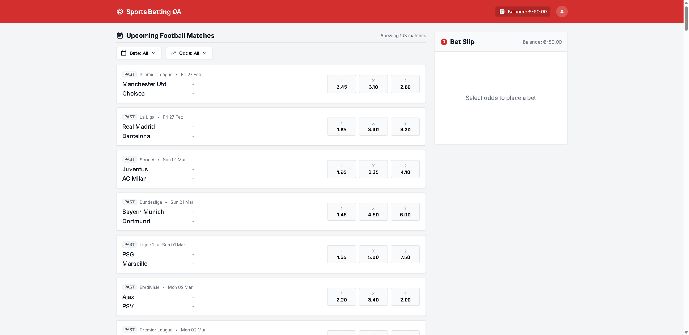<br>
<sub>After two €100 bets in the app: balance €-80.00</sub>

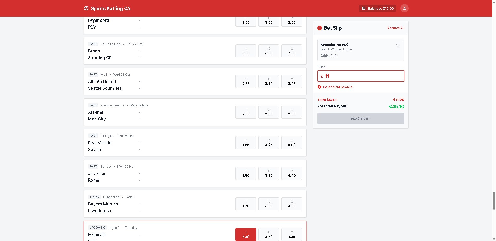<br>
<sub>UI with an up to date balance of €10: stake €11 is blocked</sub>

<br>
<sub>After the same bet through the API: balance €-1.00</sub>

</details>

<details>
<summary><b>BUG-01: Receipt shows the home and away teams reversed</b> · High</summary>

| Field | Details |
|---|---|
| Severity | High |
| Layer | UI (receipt) |
| Found in | TC-01 |

Steps to reproduce
1. Bet on Ajax (home) vs AZ Alkmaar (away).
2. Look at the "Match" field on the receipt.

Expected: "Ajax vs AZ Alkmaar", home team first, like in the match list and the API (`homeTeam: "Ajax"`).

Actual: "AZ Alkmaar vs Ajax". Same on Manchester Utd vs Chelsea, which showed "Chelsea vs Manchester Utd".

Business Impact: the receipt names a different fixture. AZ Alkmaar vs Ajax is also a real match in the catalog (`eredivisie-az-alkmaar-ajax-2026-07-21`), so users may think they bet on the wrong game.

Evidence:

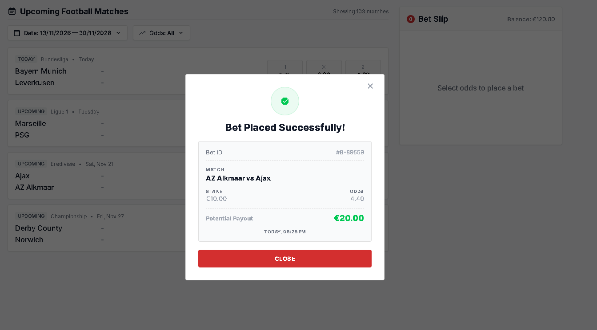<br>
<sub>Receipt: "AZ Alkmaar vs Ajax"</sub>

<br>
<sub>Receipt: "Chelsea vs Manchester Utd"</sub>

</details>

<details>
<summary><b>BUG-02: Receipt doesn't show the selected outcome</b> · High</summary>

| Field | Details |
|---|---|
| Severity | High |
| Layer | UI (receipt) |
| Found in | TC-01 |

Steps to reproduce
1. Select Ajax vs AZ Alkmaar, outcome 2 (bet slip shows "Match Winner: Away").
2. Place the bet and look at the receipt.

Expected: the receipt shows the selection (§2.4), e.g. "Away (AZ Alkmaar)".

Actual: no selection. Only Bet ID, Match, Stake, Odds, Payout and the time.

Business Impact: together with BUG-01, the user can't tell from the receipt what they bet on.

Evidence:

<br>
<sub>Receipt: no selection shown</sub>

</details>

<details>
<summary><b>BUG-03: Receipt shows the wrong payout</b> · High</summary>

| Field | Details |
|---|---|
| Severity | High |
| Layer | UI (receipt only) |
| Found in | TC-01 |

Steps to reproduce
1. Select Ajax vs AZ Alkmaar, outcome 2 (odds 4.40).
2. Enter `10`. The bet slip shows a payout of €44.00.
3. Click Place Bet and look at the receipt.

Expected: receipt payout = stake × odds = €44.00, same as the bet slip.

Actual: the receipt shows €20.00. Happened again on a second bet (10 × 2.45 showed €20.00 instead of €24.50). The bet slip and the API response (`"payout": 44`) are correct, so the problem is only in the receipt. In every bet I placed the receipt showed stake × 2, whatever the odds (€10 → €20, €2 → €4).

Business Impact: the receipt is the user's only proof of the bet, and it shows the wrong amount. That leads to disputes and support tickets.

Evidence:

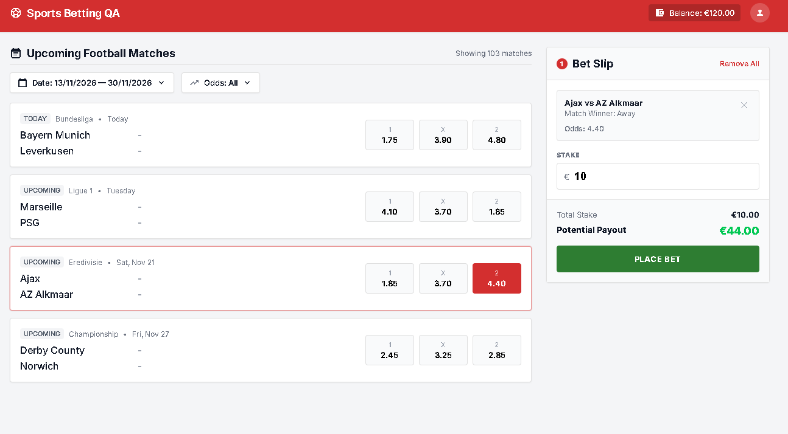<br>
<sub>Bet slip: payout €44.00 (correct)</sub>

<br>
<sub>Receipt: payout €20.00 (wrong)</sub>

</details>

<details>
<summary><b>BUG-10: The same bet is placed more than once when requests arrive at the same time</b> · High</summary>

| Field | Details |
|---|---|
| Severity | High |
| Layer | API |
| Found in | Exploratory (TC-05 area, not executed) |

Steps to reproduce
1. `POST /api/reset-balance` (balance €120).
2. Send 5 identical `POST /api/place-bet` requests at the same time, stake `10`. I used this:
   ```python
   from concurrent.futures import ThreadPoolExecutor

   body = {"matchId": "ligue-1-marseille-psg-2026-11-17", "selection": "HOME", "stake": 10}
   with ThreadPoolExecutor(5) as ex:
       results = list(ex.map(lambda _: api.place_bet(body), range(5)))
   ```
3. Check the status codes and `GET /api/balance`.

Expected: one bet is placed, the other requests get 409, and the balance drops by €10 once.

Actual: the 409 works only some of the time. Results from 4 runs:

| Run | Status codes | Balance |
|---|---|---|
| 1 | 200, 409, 409, 200, 200 | 120 → 90 (3 bets) |
| 2 | 200, 409, 409, 200, 409 | 120 → 100 (2 bets) |
| 3 | 409, 409, 200, 409, 409 | 120 → 110 |
| 4 | 200, 409, 409, 409, 409 | 120 → 110 |

Looks like a race condition in the duplicate check.

Business Impact: a double click or a network retry can charge the user two or three times for one bet.

Evidence: results above

</details>

<details>
<summary><b>BUG-17: Clicking Place Bet several times places several bets</b> · High</summary>

| Field | Details |
|---|---|
| Severity | High |
| Layer | UI (related to BUG-10 in the API) |
| Found in | Exploratory (TC-05 area, not executed) |

Steps to reproduce
1. Reset the balance (€120).
2. Select any upcoming odds and enter stake `10`.
3. Click Place Bet, and keep clicking while it shows `Placing...`.

Expected: one bet, €10 deducted once. The button is disabled while placing, and the flow ends in one final outcome (§2.3).

Actual: the button shows `Placing...` but stays enabled. Every click sends a new request:

| Clicks | Gap between clicks | Bets placed | Receipts shown |
|---|---|---|---|
| 2 | 1000 ms | 2 | 1 |
| 2 | 500 ms | 2 | 1 |
| 3 | 500 ms | 3 | 1 |
| 5 | fast | 5 | 1 |

A normal double click, even a full second apart, places two bets. Each accepted request returns "Bet placed successfully" and takes another €10, so the server treats them as separate bets. The 409 ("A bet is already being processed for this user") only catches clicks sent within a few milliseconds, see BUG-10. The user sees one receipt with one Bet ID.

Business Impact: users get charged several times for one bet without knowing it, since only one receipt is shown. That means refunds, disputes and a compliance risk.

Evidence:

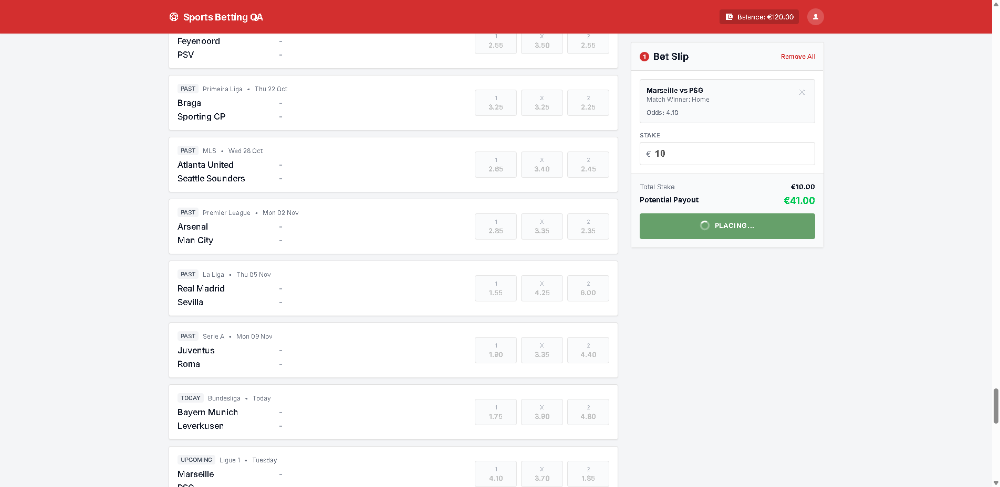<br>
<sub>Place Bet shows Placing... but is still enabled</sub>

</details>

<details>
<summary><b>BUG-04: Header and bet slip balance don't update after a bet</b> · Medium</summary>

| Field | Details |
|---|---|
| Severity | Medium |
| Layer | UI |
| Found in | TC-01 |

Steps to reproduce
1. Note the balance (header, bet slip and `GET /api/balance`: €120.00).
2. Place a €10 bet.
3. Close the receipt and check the header and the bet slip.
4. Refresh the page.

Expected: both show €110.00 right after the bet (§2.3, the stake is deducted and the balance is shared).

Actual: both still show €120.00 until the page is refreshed. `GET /api/balance` correctly returns €110.

Business Impact: users see more money than they have, and the UI lets them bet it: two €100 bets in a row take the balance to €-80 (BUG-09). They may also place the same bet again, thinking the first one didn't go through.

Evidence:

<br>
<sub>€120.00 still shown behind the receipt</sub>

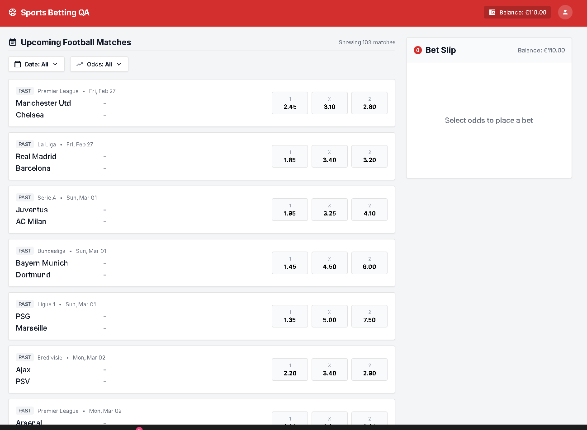<br>
<sub>€110.00 only after a refresh</sub>

</details>

<details>
<summary><b>BUG-05: <code>place-bet</code> returns currency USD instead of EUR</b> · Medium</summary>

| Field | Details |
|---|---|
| Severity | Medium |
| Layer | API |
| Found in | TC-01 / TC-02 (API) |

Steps to reproduce: send any valid `POST /api/place-bet` and compare `currency` with `GET /api/balance`.

Expected: `"currency": "EUR"` (§3, §5.3).

Actual: `place-bet` returns `"USD"`, while `GET /api/balance` returns `"EUR"` for the same user.

Business Impact: any client or report that reads the currency from this response will show the amounts in the wrong currency.

Evidence: API responses in BUG-06 and BUG-07

</details>

<details>
<summary><b>BUG-08: <code>reset-balance</code> response doesn't match the stored balance</b> · Medium</summary>

| Field | Details |
|---|---|
| Severity | Medium |
| Layer | API |
| Found in | Exploratory |

Steps to reproduce
1. `POST /api/reset-balance`
2. `GET /api/balance`

Expected: both return the starting balance of €125.50 (§5.3: response and stored state must match after a reset).

Actual:
```
POST /api/reset-balance → {"message":"Balance reset successfully","balance":125.5,"currency":"EUR"}
GET  /api/balance       → {"balance":120,"currency":"EUR"}
```
Happens on every reset. Swagger even says the "response payload may differ from persisted balance", which goes against the spec.

Business Impact: the API reports a balance that isn't real, and the user starts with €5.50 less than they should. Anything that trusts the reset response gets the wrong number.

Evidence: responses above

</details>

<details>
<summary><b>BUG-11: API payout is sometimes €0.01 lower than stake × odds</b> · Medium</summary>

| Field | Details |
|---|---|
| Severity | Medium |
| Layer | API |
| Found in | Exploratory (TC-01 area) |

Steps to reproduce: `POST /api/place-bet` on `ligue-1-marseille-psg-2026-11-17`, selection `HOME` (odds 4.10), with stakes 1, 11, 50 and 60. Compare `payout` with stake × odds.

Expected: payout = stake × odds, to the cent.

Actual:

| Stake | Odds | Expected | API payout |
|---|---|---|---|
| 1 | 4.10 | 4.10 | 4.09 |
| 11 | 4.10 | 45.10 | 45.09 |
| 50 | 4.10 | 205.00 | 204.99 |
| 60 | 4.10 | 246.00 | 245.99 |
| 10 | 4.10 | 41.00 | 41 (correct) |
| 7 | 1.85 | 12.95 | 12.95 (correct) |

Looks like a floating point result being cut instead of rounded (4.1 × 60 = 245.99999...). The bet slip shows the correct amount for the same bet, so the UI and the API disagree.

Business Impact: on some bets the user gets 1 cent less than they should. Small per bet, but it is a systematic error in a money calculation.

Evidence:

<br>
<sub>Bet slip: €11 at 4.10 shows €45.10. The API returned 45.09 for the same bet</sub>

</details>

<details>
<summary><b>BUG-12: Malformed JSON returns 500 instead of 400</b> · Medium</summary>

| Field | Details |
|---|---|
| Severity | Medium |
| Layer | API |
| Found in | Exploratory (TC-06 area) |

Steps to reproduce: `POST /api/place-bet` with headers `x-user-id: <id>` and `Content-Type: application/json`, and the body `{bad json`.

Expected: 400 (bad request), as listed in the API error codes.

Actual:
```
500 {"error":"internal_server_error","message":"Unable to process request."}
```

Business Impact: a client mistake is reported as a server failure. It hides the real cause from the client and adds false alarms to monitoring.

Evidence: response above

</details>

<details>
<summary><b>BUG-14: Odds filter accepts min higher than max without any message</b> · Medium</summary>

| Field | Details |
|---|---|
| Severity | Medium |
| Layer | UI |
| Found in | Exploratory (filters) |

Steps to reproduce
1. Open the odds filter.
2. Set Min `5` and Max `2`.
3. Click Apply.

Expected: the range is rejected with a clear message (§2.6: "must reject invalid ranges with clear feedback").

Actual: Apply works, the label shows "Odds: 5.00 - 2.00" and the match list is empty, with no message.

Business Impact: the user sees no matches and no reason why, and may think there is nothing to bet on.

Evidence:

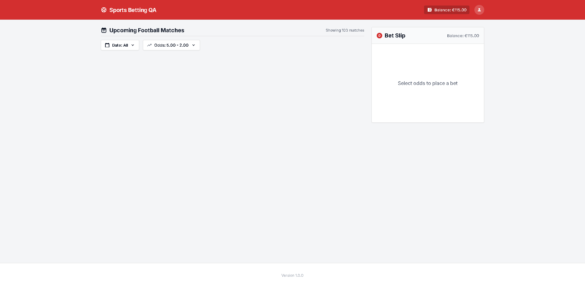<br>
<sub>Odds filter 5.00 - 2.00 applied: empty list, no message, counter still says 103</sub>

</details>

<details>
<summary><b>BUG-15: Odds filter leaves out matches with odds equal to the min or max</b> · Medium</summary>

| Field | Details |
|---|---|
| Severity | Medium |
| Layer | UI |
| Found in | Exploratory (filters) |

Steps to reproduce
1. Open the odds filter, set Min `6` and Max `8`, click Apply.
2. Compare with `GET /api/matches`: 5 matches have odds between 6.00 and 8.00.

Expected: the range is inclusive (§2.6), so all 5 are shown.

Actual: only 3 are shown. The 2 missing ones have odds of exactly 6.00 (`bundesliga-bayern-dortmund` and `la-liga-real-madrid-sevilla-2026-11-05`, away odds 6). The max is not inclusive either: 6.00 - 6.00 and 7.50 - 7.50 show nothing, although matches with those odds exist. 5.99 - 6.01 shows the 2 missing matches.

Business Impact: users filtering for a price miss matches that are exactly at the price they asked for.

Evidence: results above

</details>

<details>
<summary><b>BUG-13: <code>GET /api/place-bet</code> returns 200 instead of 405</b> · Low</summary>

| Field | Details |
|---|---|
| Severity | Low |
| Layer | API |
| Found in | Exploratory (TC-06 area) |

Steps to reproduce: `GET /api/place-bet` with header `x-user-id: <id>`.

Expected: 405 (method not allowed).

Actual: `200 {}`

Business Impact: minor. A client using the wrong method gets a success response instead of a clear error.

Evidence: response above

</details>

<details>
<summary><b>BUG-16: Match counter doesn't update after filtering</b> · Low</summary>

| Field | Details |
|---|---|
| Severity | Low |
| Layer | UI |
| Found in | Exploratory (filters) |

Steps to reproduce: apply any odds or date filter, e.g. odds 1.30 - 1.50, or the date 18/11/2026.

Expected: the counter shows how many matches are listed.

Actual: it always says "Showing 103 matches". With odds 1.30 - 1.50 there are 4 matches in the list, with 5.00 - 2.00 or the date 18/11/2026 there are none.

Business Impact: minor, but the counter contradicts what the user sees.

Evidence:

<br>
<sub>Odds filter 5.00 - 2.00 applied: empty list, no message, counter still says 103</sub>

</details>

## Observations (not bugs against the spec)

- No bet history endpoint. A bet can only be checked through the receipt, the `place-bet` response and the balance. That makes it harder to test (see STRATEGY.md).
- Auth is just an `x-user-id` header sent by the client (§5.1). Anyone who knows an ID can use that account. It matches the spec, but it is a security risk (see STRATEGY.md).
- Minimum stake: both UI and API accept €1.00 (as in §3/§4.4), but §4.1 says €1.01. Needs a decision from the PO.
